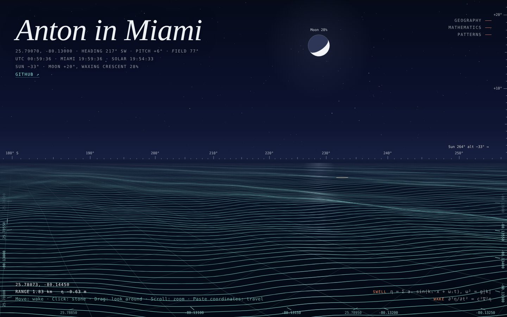
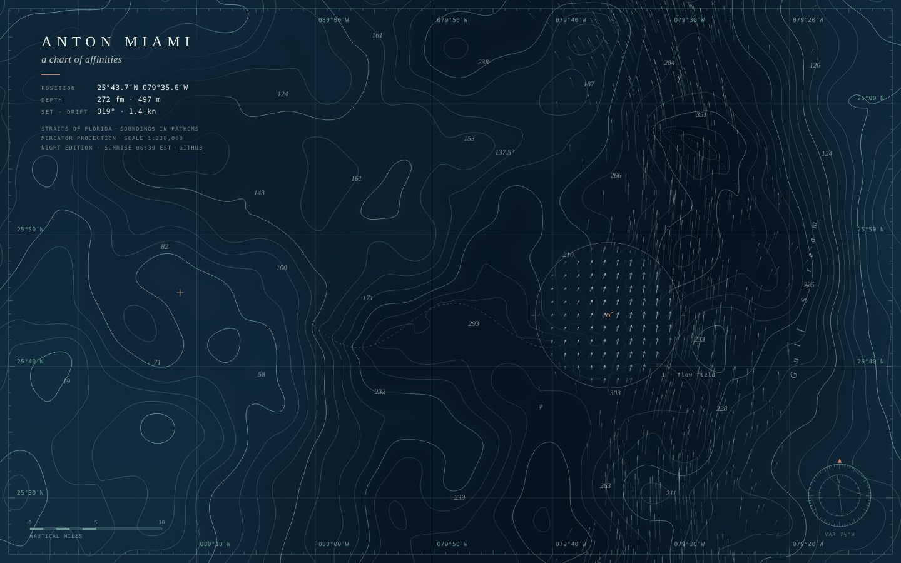

# anton.miami

[](https://github.com/avguchenko/anton.miami/actions/workflows/ci.yml)

**[anton.miami](https://anton.miami)**: my front page. It's a living chart of the sea off Miami,
drawn from geography, mathematics and patterns, and it answers when you move the pointer.

There are two designs, and the site is an A/B test between them: each visitor is randomly shown one,
and I measure which one people actually spend time with.

| `dawn`: *Anton in Miami* | `chart`: *Anton Miami* |
|---|---|
| [](https://anton.miami/?v=dawn) | [](https://anton.miami/?v=chart) |
| A line-drawn sea under the sun, moon and stars as they are right now. The pointer leaves a wake (a 2-D wave equation), clicks drop stones, dragging turns the view, and pasting coordinates takes you anywhere. | A bathymetric chart of the Straits of Florida: contour lines from noise fields, the Gulf Stream as a particle flow, depth soundings, Voronoi and vector-field layers under a reveal lens, and Mercator ↔ orthographic projections. |

## How it works

```
                ┌──────────────── Cloudflare Worker (src/worker.js) ────────────────┐
 visitor ──▶ /  │ first visit: pick dawn|chart at random → cookie (sticky)          │──▶ page + /ab/track.js
                │ www.anton.miami → 301 → anton.miami                               │
 browser ─▶ /ingest/* ─────────── first-party proxy ──────────────────────────────▶ PostHog
                └───────────────────────────────────────────────────────────────────┘
```

- **Edge split, no flicker.** The Worker chooses the variant before any HTML is sent, with no client-side
  swapping and no redirect. The URL stays `anton.miami/`.
- **Measures behaviour, not just clicks.** Both pages are one big canvas, so `public/ab/track.js` records
  attention time, pointer travel, taps, drags, keys, a coarse position heat grid and outbound clicks,
  plus PostHog session replay that includes the canvas.
- **Privacy:** honours Global Privacy Control and Do Not Track, uses an anonymous visitor ID, and
  has no ads or third-party cookies. Analytics go through the site's own domain.
- **Stack:** Cloudflare Workers + static assets, PostHog, vanilla JS/Canvas, no build step.
  Deploys automatically on push to `main` (Workers Builds), with CI running unit tests and a dry-run build.

### Repository layout

```
public/
  variants/dawn/index.html     variant A (design source: ../anton.miami/index.html)
  variants/chart/index.html    variant B (design source: ../anton.miami/alternative1/index.html)
  ab/track.js                  shared tracking (PostHog + behavioural events)
  og.png                       neutral link-preview card (same for both variants)
src/worker.js                  split + cookie + www redirect + PostHog proxy
test/worker.test.js            unit tests for the Worker (node --test)
scripts/sync_pages.py          copies in new designs and re-applies the A/B additions
scripts/ship.sh                npm run ship: sync → check → commit → push
wrangler.jsonc                 Worker config (variants, weights, experiment name, domains)
```

### Commands

| | |
|---|---|
| `npm run ship` | publish the latest designs (Cloudflare deploys on push) |
| `npm run dev` | run locally at http://localhost:8787 (try `/?v=chart&ab_debug=1`) |
| `npm test` | Worker unit tests |
| `npm run check` | syntax check + dry-run Worker build |
| `npm run analyze` | pull PostHog data → `reports/latest.md` (see Analysis) |
| `npm run schedule` | run the analysis every morning on this Mac |
| `npm run autoship` | check the design folder hourly and publish changes automatically |

## One-time setup

### 1. PostHog
1. Create a free account at posthog.com (US cloud) and a project called `anton.miami`.
2. Copy the **Project API key** (`phc_…`) into `POSTHOG_KEY` at the top of `public/ab/track.js`.
3. In the project settings, turn on **Session replay**, **Heatmaps** and **Autocapture**.
   *Web analytics* works out of the box.
4. If you chose the EU cloud instead, set `POSTHOG_UI` in `track.js` to `https://eu.posthog.com`
   and `POSTHOG_REGION` in `wrangler.jsonc` to `"eu"`.

Until a real key is in place the tracker runs in "keyless" mode: it sends nothing and logs every event to the
browser console.

### 2. Cloudflare
1. **Free the domain from the `yardsale` Worker.** `anton.miami` and `www.anton.miami` are attached
   to the `yardsale` Worker as custom domains (that's what redirects them today). In
   Workers & Pages → **yardsale** → Settings → **Domains & Routes**, remove `anton.miami` and
   `www.anton.miami`. Keep `yardsale.anton.miami`; Yard Sale keeps working, it just isn't linked
   from the front page.
2. Deploy this Worker right away (next step). It claims both domains, and `www` redirects to the root.
3. **Deploy.** Choose one:
   - *Git-connected (recommended):* Workers & Pages → Create → **Import a repository** →
     `avguchenko/anton.miami`, production branch `main`. Leave the build command blank; the deploy command is
     `npx wrangler deploy`. Every push to `main` redeploys.
   - *From your Mac:* `npm install && npx wrangler login && npx wrangler deploy`.
4. `wrangler.jsonc` attaches the Worker to `anton.miami` as a custom domain. If the
   deploy complains about it, add it by hand under Worker → Settings → Domains & Routes.

### 3. Exclude yourself
Open `https://anton.miami/?ab_optout=1` once in every browser and on every phone you use (undo with
`?ab_optout=0`). Visitors with Global Privacy Control or Do Not Track turned on are never tracked.

## Publishing updates

The page designs are edited in the separate `anton.miami` folder next to this repo. To publish:

```
npm run ship                       # or: npm run ship -- "what changed"
```

That pulls from GitHub, copies in the latest `../anton.miami/index.html` (dawn) and
`../anton.miami/alternative1/index.html` (chart), re-applies the tracking/preview tags/links,
checks everything, commits and pushes. Cloudflare **Workers Builds** is connected to the repo
and deploys every push to `main` automatically, so there is no deploy command to run.

### Hourly auto-publish

`npm run autoship` installs a launchd job on the Mac that checks the design folder every hour
and publishes changes on its own: the same sync → check → commit → push as `npm run ship`.
It waits until the files have been untouched for 10 minutes (so a page isn't grabbed mid-edit),
skips if this repo has unrelated local changes, refuses pages that look truncated or lost
their tracking, and posts a macOS notification when something goes live. Its commits are unsigned (signing
would need a click from you); manual commits are unaffected.
`npm run autoship -- status` shows the last few checks; `-- off` removes it.

## Links to share

LinkedIn and most apps hide where a click came from, so give each profile its own tagged link:

| Where | Link |
|---|---|
| LinkedIn profile / featured | `https://anton.miami/?utm_source=linkedin&utm_medium=profile` |
| LinkedIn post | `https://anton.miami/?utm_source=linkedin&utm_medium=post` |
| GitHub profile | `https://anton.miami/?utm_source=github&utm_medium=profile` |
| X / Instagram / other | `https://anton.miami/?utm_source=<site>&utm_medium=profile` |
| Email signature | `https://anton.miami/?utm_source=email&utm_medium=signature` |

The link preview (title, description, `og.png`) is identical for both variants, so it can't favour
either one. After deploying, paste the URL into LinkedIn's **Post Inspector**
(linkedin.com/post-inspector) to refresh LinkedIn's cached preview.

## Previewing variants

- `https://anton.miami/?v=dawn` or `?v=chart` forces a variant. It isn't stored and is flagged `ab_preview`.
- `https://anton.miami/variants/dawn/` opens the page directly (`noindex`, also flagged `ab_preview`).
- Add `&ab_debug=1` to print every tracking event to the console.

## What's measured

Every event carries `variant`, `ab_experiment`, `ab_assignment` (`new` / `returning` / `forced`), `ab_preview` and `page_id` (one per page load). `ab_exposure` also records `in_app_browser` (LinkedIn's in-app browser etc.), `cpu_cores`, `device_memory_gb` and `connection`.

| Event | When | Key properties |
|---|---|---|
| `ab_exposure` | page load | viewport, `input_class` (mouse/touch), `reduced_motion`, `referrer_domain`, `utm_*` |
| `first_interaction` | first move / tap / key | `kind`, `ms_to_first` |
| `engaged` | 10, 30, 60, 120, 300 s of *visible* time | `seconds`, `interacted` |
| `key_used` | first press of each distinct key | `key` |
| `ui_click` | in-page buttons (projection, edition) | `control` |
| `coords_pasted` | pasting coordinates (dawn) | `moved`, `place` |
| `view_changed` | URL hash changes | `hash` |
| `outbound_click` | any link off the site | `destination`, `href`, `label`, `seconds_on_page` |
| `perf` | after 6 visible seconds | `fps`, `fps_min_1s`, `long_frames`, `load_ms`, `transfer_kb`: the designs differ a lot in weight and rendering cost, so this controls for speed |
| `page_summary` | tab hidden / page closed | `visible_s`, `attentive_s` (visible + input in the last 15 s), `exit` (`outbound`/`left`), `exit_href`, `pointer_travel_screens`, `taps`, `drags`, `keys`, `distinct_keys`, `max_idle_s`, `heat_grid` (12×8, % of pointer time per cell) |

PostHog's own data covers the rest: `$pageview` / `$pageleave`, autocaptured clicks, **heatmaps**
(click, rage-click and mouse-movement overlays in the Toolbar) and **session replays** that
include the canvas at 2 fps, so you can watch the cursor move over the actual animation. To turn
canvas recording off, set `RECORD_CANVAS = false` in `track.js`.

`page_summary` can fire more than once per page load when someone tabs away and back. Its
numbers are cumulative within that load, so keep the row with the highest `seq` per `page_id`,
then roll page loads up into sessions (the SQL below does this). `max_idle_s` includes the idle
stretch still running when the visitor leaves.

## Analysis

`npm run analyze` pulls the experiment's events from PostHog, rolls them up **per visitor** (the
unit the Worker randomises), and writes `reports/latest.md`, a dated copy, and a per-visitor CSV in
`data/`. Both folders are git-ignored.

The report covers:
- **a verdict line:** keep running / winner / no clear winner / something's broken, judged against the pre-registered plan
  (primary metric, 356 visitors per arm), with an ETA at the current traffic rate
- **primary metric:** engaged ≥ 30 s, with Newcombe 95% CI, z-test p and Bayesian P(better)
- **secondary metrics:** interaction, outbound clicks, bounce, visible/attentive time, pointer travel,
  time to first input (bootstrap CIs, Mann–Whitney)
- **segments:** mouse vs touch, in-app browsers, top traffic sources
- **performance as a confounder:** frame rate and load time per design
- **data quality:** sample-ratio-mismatch check, visitors who saw both designs, missing summaries

Setup (once, on the Mac):
1. PostHog → avatar → **Settings → User → Personal API keys → Create**, scopes **Query: Read** and
   **Project: Read**. (This is different from the public `phc_` key in `track.js`.)
2. `cp .env.example .env` and fill in the key and your **Project ID** (Settings → Project → General).
3. `npm run analyze` to check it works. Try `npm run analyze -- --demo` first to see a sample report.
4. `npm run schedule`: runs it every morning at 08:17 via launchd and posts a macOS notification
   with the headline. `npm run schedule -- status` / `-- off` to check or remove.

## Running the test properly

**Decide the primary metric before you look at results.** Suggested:

> **Primary:** share of exposed visitors who stay **≥ 30 s visible** (`engaged` with `seconds = 30`).
> **Secondary:** interaction rate (`first_interaction`), median `attentive_s`, outbound click-through.
> **Guardrail:** bounce under 10 s.

Always filter `ab_preview = false`, and segment by `input_class`, because phone and mouse visitors
behave very differently on these pages.

**Sample size.** To detect a move from 30% to 40% engaged at 95% confidence / 80% power you need about
**360 visitors per variant (~720 total)**. Profile traffic is modest, so plan on several weeks.
Settle the stopping point up front (a visitor count or a date) and don't stop early because one
variant pulls ahead. Early leads at small sample sizes are mostly noise.

### PostHog insights to build
1. **Funnel:** `ab_exposure` → `engaged` (seconds = 30), broken down by `variant`. Filter `ab_preview = false`.
   PostHog shows the conversion rates; the significance check is below.
2. **Funnel:** `ab_exposure` → `outbound_click`, by `variant`.
3. **Trend:** `page_summary` → median of `attentive_s`, by `variant`.
4. **Web analytics** → filter `variant`, to see referrers and UTM sources.

### SQL (PostHog → SQL editor)
```sql
-- 1) one row per page load: the final page_summary of that load
WITH loads AS (
  SELECT
    any(properties.variant)                                   AS variant,
    any(properties.$session_id)                               AS sid,
    argMax(toFloat(properties.visible_s),   toInt(properties.seq)) AS visible_s,
    argMax(toFloat(properties.attentive_s), toInt(properties.seq)) AS attentive_s,
    argMax(properties.exit,                 toInt(properties.seq)) AS exit,
    argMax(toFloat(properties.pointer_travel_screens), toInt(properties.seq)) AS travel
  FROM events
  WHERE event = 'page_summary'
    AND properties.ab_preview = false
    AND properties.ab_experiment = 'front-page-2026-11'
  GROUP BY properties.page_id
),
-- 2) roll page loads (reloads, extra tabs) up into sessions
s AS (
  SELECT variant, sid,
    sum(visible_s)            AS visible_s,
    sum(attentive_s)          AS attentive_s,
    max(exit = 'outbound')    AS clicked_out,
    sum(travel)               AS travel
  FROM loads
  GROUP BY variant, sid
)
SELECT
  variant,
  count()                                AS sessions,
  round(avg(visible_s >= 30) * 100, 1)   AS pct_engaged_30s,
  quantile(0.5)(visible_s)               AS median_visible_s,
  quantile(0.5)(attentive_s)             AS median_attentive_s,
  round(avg(clicked_out) * 100, 1)       AS pct_clicked_out,
  round(avg(travel), 1)                  AS avg_pointer_travel_screens
FROM s
GROUP BY variant
ORDER BY variant
```
For the significance check on the primary metric, put the two `sessions` / `pct_engaged_30s` pairs
into a two-proportion z-test. PostHog's experiment calculator or any online A/B significance
calculator works.

## Changing the experiment
- **Weights:** `WEIGHTS` in `wrangler.jsonc` (e.g. `"1,3"`).
- **New round** (e.g. a third design): add `public/variants/<name>/index.html` with
  `<meta name="ab-variant" content="<name>">` and the `track.js` script tag, add it to `VARIANTS`,
  and change `EXPERIMENT`. Changing `EXPERIMENT` re-randomises everyone.
- **Ending the test:** set `VARIANTS` to the winner alone.

## License

Borrow freely. The **code** (Worker, tracking, scripts) is [MIT](LICENSE). The **page designs**
are [CC BY-NC 4.0](public/variants/LICENSE.md): learn from them, remix them, credit me. Please
don't republish them as your own homepage.
